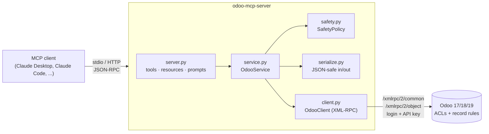

# odoo-mcp-server

**Let Claude (or any MCP client) talk to your Odoo database, read-only by default and guarded by a safety policy.**

[](LICENSE)
[](https://www.python.org/)
[](https://www.odoo.com/)
[](https://modelcontextprotocol.io/)
[](https://github.com/astral-sh/ruff)

`odoo-mcp-server` is a [Model Context Protocol](https://modelcontextprotocol.io/) server that
exposes an Odoo database to AI assistants as a small set of well-documented tools. You can
ask *"Which US companies haven't ordered this quarter?"* and the assistant finds the models,
reads their fields, builds the domain and pages through the results without any custom
integration code.

It connects with a **login + API key** over Odoo's external API. Every call runs as that
user, so **Odoo's own access rights and record rules still apply**. On top of those, the
server adds its own safety layer, which is the main point of this project.

---

## Features

- **Discovery tools**: `list_models` finds models and `describe_model` returns fields,
  types, required/readonly flags, relations, selection values, and what the user may do.
- **Query tools**: `search_records` (domain, fields, limit, offset, order, paging hints),
  `read_record`, `count_records`.
- **Opt-in write tools**: `create_record`, `update_record`, `delete_record`. They are only
  *registered* when enabled, so in read-only mode the assistant never sees them.
- **Model-friendly output**: many2one becomes `{"id", "name"}`, empty values become `null`
  instead of Odoo's `False`, and binary fields are replaced by a size marker so they don't
  fill the context window.
- **Model-friendly input**: a many2one accepts `7` or `{"id": 7}`, an x2many accepts a plain
  list of ids (or Odoo commands), `null` clears a field, and a domain can be a list or a JSON string.
- **Actionable errors**: *"Field 'emial' does not exist on 'res.partner'. Did you mean: email?"*
  Odoo tracebacks are reduced to a single readable line.
- **Resources and prompts**: `odoo://server-info`, `odoo://models/{model}`, plus the
  `sales_summary` and `explore_model` prompt templates.
- **Operational extras**: a `--check` connection test, stdio and streamable-HTTP transports,
  request timeouts, thread-safe client, and a `fields_get` cache.

## The safety model

| Layer | Default | How to change |
|---|---|---|
| **Read-only mode** | Only the five read tools exist | `ODOO_MCP_ALLOW_WRITE=1` adds create/update |
| **Deletes** | Disabled even when writes are on, including indirect deletes through x2many commands (see below) | `ODOO_MCP_ALLOW_DELETE=1` (requires write) |
| **Built-in denylist** | API keys, `ir.config_parameter`, `ir.rule`, `ir.model.access`, `ir.model.fields`, `ir.actions.server`, `base.automation`, `ir.cron`, `ir.ui.view`, `ir.asset`, `ir.module.*`, mail servers, payment providers, ... | Cannot be disabled |
| **Your denylist** | none | `ODOO_MCP_DENY_MODELS=hr.*,account.*` (glob patterns) |
| **Allowlist** | all models (except denied) | `ODOO_MCP_MODELS=res.partner,sale.*` |
| **Result size** | 50 per page, hard cap 200 | `ODOO_MCP_DEFAULT_LIMIT`, `ODOO_MCP_MAX_LIMIT` |
| **Batch size** | max 100 ids per update/delete | n/a |
| **Relation guard** | Dotted domain paths (`partner_id.country_id.code`) and `any` sub-domains are checked hop by hop and may not pass through a blocked model; x2many create/update commands may not write into a blocked model | n/a |
| **Argument validation** | domains (shape, operators, field names on every hop, prefix-notation arity), field lists, `order` clauses (injection-proof), ids, write values (types, selections, read-only computed fields, x2many command codes) | n/a |
| **Odoo permissions** | Every call runs as the API-key user | Use a dedicated, least-privilege Odoo user |

Updates and deletes first check that **all** ids exist and are accessible. If any are
missing, nothing is changed.

**x2many writes and deletes.** In Odoo, removing lines from a one2many on an existing record
(commands `3`, `5`, `6`, or a plain list of ids, which becomes `6`) *deletes* those lines when
the inverse field is `ondelete="cascade"`, as it is for order lines. Command `2` always
deletes. Because of that, these commands need `ODOO_MCP_ALLOW_DELETE=1` as well; in
write-only mode the assistant can still add lines (`[[0, 0, {...}]]`) or link them
(`[[4, id]]`), and many2many sets (`[1, 2]`) work as usual.

> **Tip:** create a dedicated Odoo user for the assistant (e.g. `assistant@yourcompany.com`)
> with only the groups it needs, and generate the API key for that user. The server's policy
> and Odoo's ACLs then work together.

## Architecture



A typical `search_records` call:

```mermaid
sequenceDiagram
    participant M as AI model
    participant S as odoo-mcp-server
    participant O as Odoo
    M->>S: search_records(model, domain, fields, limit)
    S->>S: model allowed? (built-in denylist, deny/allow lists)
    S->>O: fields_get (cached per model)
    S->>S: validate domain, fields, order; check relation paths; clamp limit
    S->>O: search_read + search_count (as the API-key user)
    O-->>S: rows (Odoo ACLs and record rules applied)
    S-->>M: {total, records, next_offset} (many2one → {id, name}, False → null)
```

| Module | Responsibility |
|---|---|
| `config.py` | Parses and validates environment variables into an immutable `Settings` |
| `client.py` | Thread-safe XML-RPC client: lazy auth, timeouts, fault → readable error |
| `safety.py` | Model policy, write gates, limits, domain/field/order validation |
| `serialize.py` | Odoo wire format ↔ JSON-friendly values |
| `service.py` | SDK-independent operations (unit-tested without MCP) |
| `server.py` | MCP tools/resources/prompts and the CLI |

## Quick start

### 1. Install

Requires Python 3.10+.

```bash
# Recommended: an isolated install with pipx
pipx install git+https://github.com/Pirainuthal/odoo-mcp-server.git

# or with uv
uv tool install git+https://github.com/Pirainuthal/odoo-mcp-server.git

# or from a clone
git clone https://github.com/Pirainuthal/odoo-mcp-server.git
cd odoo-mcp-server
python -m venv .venv && . .venv/bin/activate
pip install -e .
```

### 2. Create an Odoo API key

In Odoo: **avatar (top-right) → My Profile / Preferences → Account Security → New API Key**.
Name it, copy the key, and keep it secret. On Odoo 19 the `rpc` module must be installed;
it is auto-installed on standard databases.

### 3. Check the connection

```bash
export ODOO_URL=https://mycompany.odoo.com
export ODOO_DB=mycompany
export ODOO_USERNAME=assistant@mycompany.com
export ODOO_API_KEY=xxxxxxxxxxxxxxxx

odoo-mcp-server --check
```

```json
{
  "url": "https://mycompany.odoo.com",
  "database": "mycompany",
  "username": "assistant@mycompany.com",
  "uid": 2,
  "server_version": "19.0",
  "mode": "read-only",
  "allowed_models": "all (except denied)",
  "default_limit": 50,
  "max_limit": 200,
  "always_blocked_models": ["res.users.apikeys", "ir.config_parameter", "..."]
}
```

### 4. Connect your AI assistant

**Claude Code**

```bash
claude mcp add odoo \
  -e ODOO_URL=https://mycompany.odoo.com \
  -e ODOO_DB=mycompany \
  -e ODOO_USERNAME=assistant@mycompany.com \
  -e ODOO_API_KEY=xxxxxxxxxxxxxxxx \
  -- odoo-mcp-server
```

Add `--scope user` to make it available in every project, then run `/mcp` inside Claude
Code to confirm that the `odoo` server is connected.

**Claude Desktop**: edit `claude_desktop_config.json` (*Settings → Developer → Edit Config*):

```json
{
  "mcpServers": {
    "odoo": {
      "command": "odoo-mcp-server",
      "env": {
        "ODOO_URL": "https://mycompany.odoo.com",
        "ODOO_DB": "mycompany",
        "ODOO_USERNAME": "assistant@mycompany.com",
        "ODOO_API_KEY": "xxxxxxxxxxxxxxxx",
        "ODOO_MCP_MODELS": "res.partner,sale.*,product.*,account.move"
      }
    }
  }
}
```

If `odoo-mcp-server` isn't on the PATH Claude Desktop sees, use the absolute path (for example
`/home/you/.local/bin/odoo-mcp-server`). More examples are in [`examples/`](examples/).

**Any other MCP client**: run `odoo-mcp-server` as a stdio server. For HTTP clients:

```bash
odoo-mcp-server --transport streamable-http --host 127.0.0.1 --port 8000
# MCP endpoint: http://127.0.0.1:8000/mcp
```

> The HTTP transport has no authentication of its own: anyone who can reach it acts as the
> configured Odoo user. Keep it on localhost or put it behind an authenticating proxy.

## Configuration

| Variable | Required | Default | Description |
|---|---|---|---|
| `ODOO_URL` | yes | | Base URL, e.g. `https://mycompany.odoo.com` |
| `ODOO_DB` | yes | | Database name |
| `ODOO_USERNAME` | yes | | Login of the API-key user |
| `ODOO_API_KEY` | yes | | API key (a password also works, but isn't recommended) |
| `ODOO_MCP_ALLOW_WRITE` | | `0` | `1` registers `create_record` and `update_record` |
| `ODOO_MCP_ALLOW_DELETE` | | `0` | `1` registers `delete_record` (needs `ALLOW_WRITE=1`) |
| `ODOO_MCP_MODELS` | | *(all)* | Comma-separated allowlist; globs allowed (`sale.*`) |
| `ODOO_MCP_DENY_MODELS` | | *(none)* | Extra denylist on top of the built-in one |
| `ODOO_MCP_DEFAULT_LIMIT` | | `50` | Page size when the model doesn't pass `limit` |
| `ODOO_MCP_MAX_LIMIT` | | `200` | Hard cap on `limit` |
| `ODOO_TIMEOUT` | | `30` | XML-RPC timeout in seconds |

A template is in [`.env.example`](.env.example). The server reads the process environment;
it doesn't load `.env` files itself.

## Tools, resources and prompts

| Tool | Mode | Purpose |
|---|---|---|
| `list_models(query?, include_transient?, limit?)` | read | Find models by technical name or label |
| `describe_model(model, field_query?, include_technical?)` | read | Fields (required first), relations, selections, user's access rights |
| `search_records(model, domain?, fields?, limit?, offset?, order?)` | read | Paged search; returns `total`, `records`, `next_offset` |
| `read_record(model, record_id, fields?)` | read | One record (archived ones included) |
| `count_records(model, domain?)` | read | Fast count |
| `create_record(model, values)` | write | Returns `id` and `display_name` |
| `update_record(model, ids, values)` | write | All-or-nothing existence check, max 100 ids |
| `delete_record(model, ids)` | delete | Returns the deleted records' names |

When `fields` is omitted, `search_records` returns a compact projection (`display_name` plus
common fields such as `name`, `state`, `partner_id`, `amount_total`, and required fields).
Pass `["*"]` to get every non-binary field.

| Resource / prompt | Description |
|---|---|
| `odoo://server-info` | Version, database, user, mode and limits (never the key) |
| `odoo://models/{model}` | The `describe_model` output as a resource |
| `sales_summary(period)` | Guided, read-only sales report for a period |
| `explore_model(model)` | Guided tour of a model: purpose, key fields, sample rows |

## Example conversations

The traces below were produced against an Odoo 19 database with demo data.

**"Which US companies do we have, and what are their emails?"**

```text
→ search_records(model="res.partner",
                 domain=[["is_company","=",true],["country_id.code","=","US"]],
                 fields=["name","country_id","email"], limit=3, order="name")
← {"total": 7, "returned": 3, "next_offset": 3,
   "records": [
     {"id": 9,  "name": "Acme Corporation", "country_id": {"id": 233, "name": "United States"},
      "email": "acme_corp@yourcompany.example.com"},
     {"id": 15, "name": "Azure Interior",   "country_id": {"id": 233, "name": "United States"}, ...},
     {"id": 16, "name": "Lumber Inc", ...}]}

Claude: There are 7 US companies. The first three alphabetically are Acme Corporation,
Azure Interior and Lumber Inc. Want me to fetch the remaining four?
```

**"How many contacts have a child contact with an example.com email?"**

```text
→ count_records(model="res.partner",
                domain=[["child_ids","any",[["email","ilike","example"]]]])
← {"model": "res.partner", "count": 8}
```

**Typos are caught before Odoo sees them**

```text
→ search_records(model="res.partner", fields=["emial"])
← error: Field 'emial' does not exist on 'res.partner'. Did you mean: email?
```

**Sensitive models are off-limits regardless of who asks**

```text
→ search_records(model="res.users.apikeys")
← error: Model 'res.users.apikeys' is security-sensitive and always blocked by this server.
```

**Odoo's permissions still apply (here as a non-admin user, with writes enabled)**

```text
→ create_record(model="res.country", values={"name": "Atlantis", "code": "XA"})
← error: You are not allowed to create 'Country' (res.country) records.
         This operation is allowed for the following groups: - Role / Administrator
```

**Read-only by default**: with the default configuration, `tools/list` returns only the five
read tools, so a request like "rename Acme to Acme Inc" has no tool to act on. The
server's instructions tell the assistant that write tools appear only when they're enabled.

## Testing

```bash
python -m venv .venv && . .venv/bin/activate
pip install -e ".[dev]"

pytest              # unit tests, no Odoo needed
ruff check src tests && ruff format --check src tests
```

The unit tests use an **in-memory fake Odoo** (`tests/conftest.py`) that implements the
XML-RPC `common`/`object` services (domain evaluation, `fields_get`, `search_read`, `create`,
`write`, `unlink`, access checks and faults). They cover configuration, every safety rule,
serialization in both directions, fault translation, and the MCP layer end to end through an
in-process MCP client (tool listing, schemas, annotations, error results, prompts and
resources).

**Live smoke test** (optional, against a real server; use a test database):

```bash
export ODOO_URL=http://localhost:8069 ODOO_DB=test ODOO_USERNAME=admin ODOO_API_KEY=...
ODOO_MCP_LIVE_TEST=1 pytest tests/test_live.py                     # read-only checks
ODOO_MCP_LIVE_TEST=1 ODOO_MCP_LIVE_WRITE=1 \
  ODOO_MCP_ALLOW_WRITE=1 ODOO_MCP_ALLOW_DELETE=1 pytest tests/test_live.py   # + create/update/delete a temp partner
```

## Compatibility notes

- **Odoo 17, 18, 19** are supported. `describe_model` uses `has_access` (18+) and falls back
  to `check_access_rights` on 17.
- **Odoo 19** marks `/xmlrpc/2` as deprecated, with removal planned for Odoo 22, and logs a
  warning per call. You can mute it with `--log-handler odoo.addons.rpc.controllers.xmlrpc:ERROR`.
  A JSON-2 transport is on the roadmap.
- Built on **MCP Python SDK 2.x** (`MCPServer`, the successor of `FastMCP`).

## Roadmap

- [ ] JSON-2 API transport (`/json/2/<model>/<method>`, bearer API key) for Odoo 19+
- [ ] `read_group` / aggregation tool for reports without fetching rows
- [ ] Per-model field denylist (e.g. hide `hr.employee` private fields)
- [ ] Optional confirmation step for writes through MCP elicitation
- [ ] Audit log of write operations
- [ ] Publish to PyPI so `uvx odoo-mcp-server` works

## Contributing

Issues and pull requests are welcome. Please run `ruff format`, `ruff check` and `pytest`
before opening a PR; CI runs the same checks on Python 3.10–3.13.

## License

[MIT](LICENSE) © 2026 [Pirainuthal S](https://github.com/Pirainuthal)
